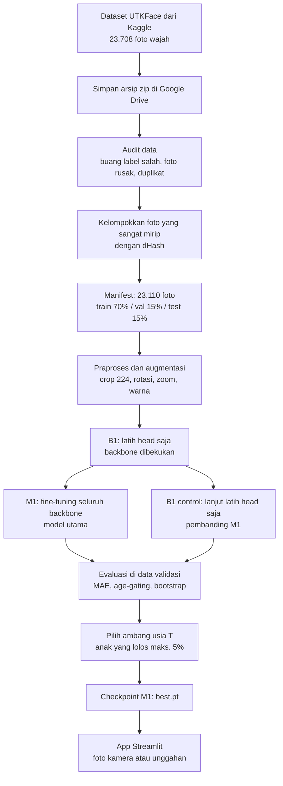

# Muka Boros Detektor: Estimasi Usia Wajah untuk Age-Gating

Model yang menebak usia seseorang dari foto wajah, lalu memutuskan apakah ia boleh mengakses konten dewasa atau perlu verifikasi tambahan. Model memakai MobileNetV3-Small agar ringan dan cepat di CPU.

## Alur: dari dataset sampai model



## Penjelasan tiap tahap

1. **Dataset.** UTKFace versi aligned and cropped. Usia, jenis kelamin, dan ras dibaca dari nama berkas (`usia_jeniskelamin_ras_waktu.jpg`).
2. **Audit.** Foto dengan nama salah format, foto rusak, dan duplikat identik dibuang. Duplikat yang labelnya berbeda dibuang semua karena labelnya tidak bisa dipercaya.
3. **Pembagian data.** Foto yang sangat mirip (kemungkinan orang yang sama) selalu ditaruh di split yang sama, supaya model tidak "menghafal" wajah yang nanti diuji. Pembagian dibuat seimbang per kelompok usia.
4. **Pelatihan.** Model dilatih bertahap:
   - **B0:** selalu menebak median usia (29 tahun). Batas bawah.
   - **B1:** model pralatih ImageNet, hanya lapisan terakhir yang dilatih.
   - **M1:** lanjutan B1, seluruh model ikut dilatih. Model ini yang dipakai di app.
   - **B1 control:** lanjutan B1 dengan pengaturan yang sama seperti M1, tetapi hanya lapisan terakhir yang dilatih. Gunanya membuktikan bahwa kenaikan M1 memang berasal dari fine-tuning.
5. **Evaluasi.** Semua angka di bawah dihitung di data validasi. Data uji dikunci sampai konfigurasi final dipilih.
6. **Age-gating.** Pengguna diterima bila tebakan usianya minimal T. T dipilih paling kecil yang tetap menjaga anak di bawah 18 tahun yang lolos tidak lebih dari 5%.

## Hasil (validasi, run r3)

| Model | Rata-rata meleset (MAE) |
|---|---|
| B0 (tebak median) | 14.41 tahun |
| B1 | 7.37 tahun |
| B1 control | 7.12 tahun |
| **M1** | **5.66 tahun** |

Age-gating M1 dengan batas 18 tahun: T = 24. Anak yang lolos 4.5%, orang dewasa yang perlu verifikasi tambahan 11.4%. Inferensi di CPU sekitar 9 ms per foto.

Rincian perbandingan antar run ada di `docs/comparison/comparison_results.md`.

## Cara menjalankan

**Melatih model** (Google Colab):
1. Buka `AgeGating_MobileNetV3Small_UTKFace.ipynb` di Colab, pilih GPU (A100 disarankan, T4 bisa).
2. Jalankan sel dari atas ke bawah. Hasil tersimpan di Google Drive, folder `age_gating_mnv3s/`.
3. Setiap kali pengaturan pelatihan diubah, ganti `RUN_TAG` di sel konfigurasi.

**Menjalankan app** (lokal):
1. Salin `runs/M1_s43_r3/best.pt` dari Drive ke `age-gating/models/age_verification_model.pt`.
2. Dari folder `age-gating/`:

```bash
uv sync
uv run streamlit run src/age_gating/app.py
```

App terbuka di http://localhost:8501. Hasil paling akurat bila foto sudah dipotong ke wajah, sama seperti foto latih.

## Struktur repo

```
AgeGating_MobileNetV3Small_UTKFace.ipynb   pelatihan dan evaluasi (Colab)
age-gating/                                app Streamlit
  models/                                  checkpoint model (tidak ikut git)
  src/age_gating/model.py                  memuat model dan memprediksi usia
  src/age_gating/app.py                    tampilan app
docs/                                      proposal dan hasil perbandingan run
```
